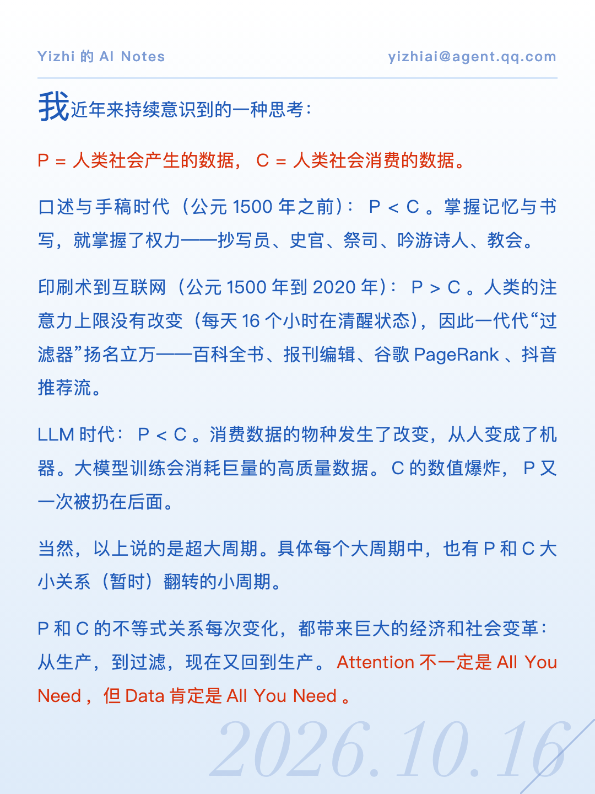
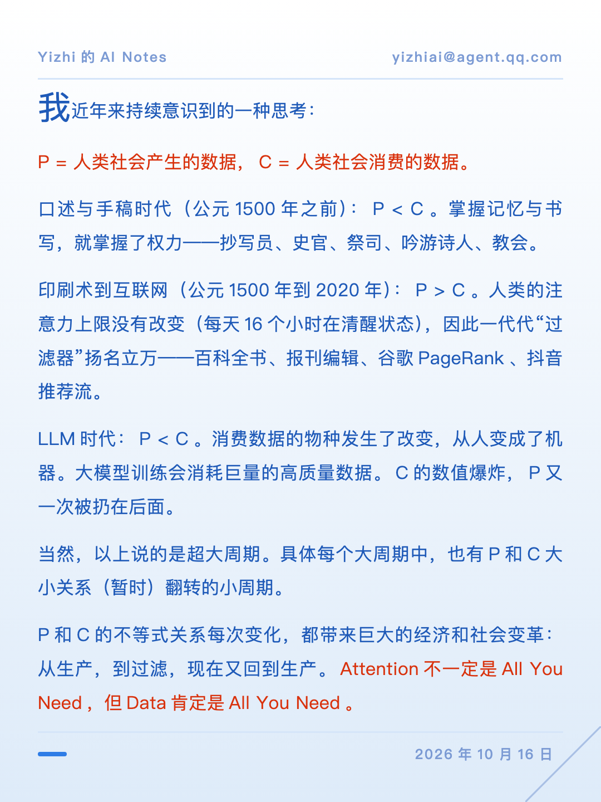
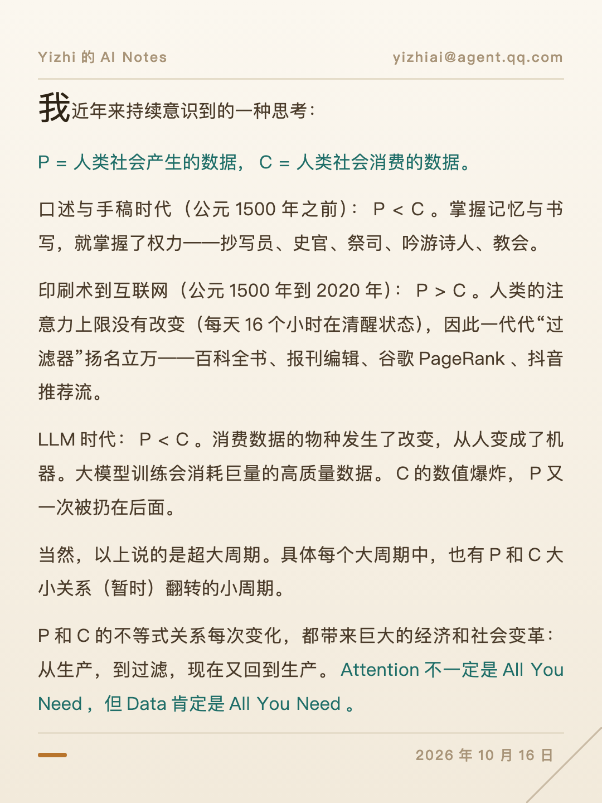

# reading-note-cards 展示小卡

把一段较长的思考 / 段落文章做成**手机上舒服读的展示卡片图**（1080×1440，4:3 竖版）。零外部依赖（Python 标准库 + 系统 Chrome 无头截图），设计为 AI Agent 的可执行 Skill（SKILL.md + 可直接修改的生成脚本）。



## 效果

每张卡片：白→蓝渐变底 → 顶部品牌 / 邮箱薄框区 → 大面积正文（**正文普通色** + **重点色**双轨）→ 右下 Didot 斜体日期大字水印与折角线。第二段用 `! ` 标记整段重点色，末段最后一句自动染重点色作为「金句收尾」。

两种日期形态：`--date-style mark`（大字水印，默认）/ `small`（页脚框线小日期）：



## 设计原则（全部实测得出）

- **字号像素不是目的，读者在手机上的字体体感才是**——卡片越方越矮，同屏显示越完整。画布从 9:16 一路收敛到 4:3。
- **单页完整性 > 大段距/大字号**：一张卡讲完一件事。段距/行距收紧但不拥挤，腾出的空间全还给字号。
- **正文普通色 + 重点色双轨**：重点色只出现在「金句收尾」和 `! ` 标记段，每套主题的重点色色相必须与正文色形成对比。
- **全卡唯一字栈 PingFang SC**：中英文数字同族（拉丁字体与中文混排会因 x-height 不齐显得字号不一）。
- 容量按盒模型精确计算 + 3% 安全余量，字号 22→15px 六档自适应，单页装不下按段落自动分页（最多 4 页）。

## 安装

```bash
git clone https://github.com/eiainano/reading-note-cards-SKILL.git
cp -r reading-note-cards-SKILL ~/.claude/skills/   # 或你的 Agent skills 目录
```

依赖：Python 3 标准库 + 本机 Chrome。macOS 开箱即用；其他平台改脚本顶部 `CHROME` 常量为 Chrome/Chromium 路径。

## 使用

```bash
# 默认（azure 白底亮蓝 + 大字日期水印）
python3 make_card.py --text-file essay.txt --brand "YourNotes" \
  --email you@example.com --date "2026年10月16日" --out card --png card.png

# 旧版页脚小日期
python3 make_card.py --text-file essay.txt --date-style small --date "2026年10月16日" --out card --png card.png

# 图文卡：配图在上 / 在下 / 整卡背景压暗（fill 仅限单页）
python3 make_card.py --text "…" --image photo.jpg --img-pos top --out c --png c.png

# 十二套配色各出一张对比
python3 make_card.py --text-file essay.txt --theme-all --outdir preview/

# 批量：cards.json（数组，字段同 CLI，支持 text_file / image / theme / png）
python3 make_card.py --cards cards.json
```

**文本内语法**：`\n\n` 分段；`**重点词**` 强调色高亮；段首 `! ` 整段重点色；段首 `> ` 浅色面板块。

## 十二套配色

每套都遵循「渐变底 = 正文普通色的极淡延伸，重点色与正文色相形成对比」：

| 主题 | 正文普通色 | 重点色 | 气质 |
|---|---|---|---|
| azure（默认） | 蓝 #1F5AB8 | 火红 #D9320D | 白蓝渐变，通用 |
| linen 亚麻纸 | 棕 #4A3B2A | 深青 #1F6E68 | 温润纸感 |
| pine 松烟 | 墨绿 #2F5233 | 酒红 #9B2242 | 清雅绿意 |
| plum 紫檀 | 紫 #4C3B78 | 琥珀金 #B8721E | 紫金高级感 |
| graphite 石墨 | 石墨黑 #2E3138 | 国际橘 #D93A1E | 极简商务 |
| dusk 暮蓝（深色） | 月白 #C2CAD9 | 暖橘 #FF8A4C | 夜间模式 |
| paper / noir / mist / matcha / blush / mono | — | — | 更多质感备选 |



## 适用场景

- 论文 / 报告 / 博客重点段落的社交媒体分享
- 日常思考、读书笔记的「卡片化」沉淀
- 任何「这段话值得做成图发出去」的时刻

## License

MIT — 详见 [LICENSE](LICENSE)。
